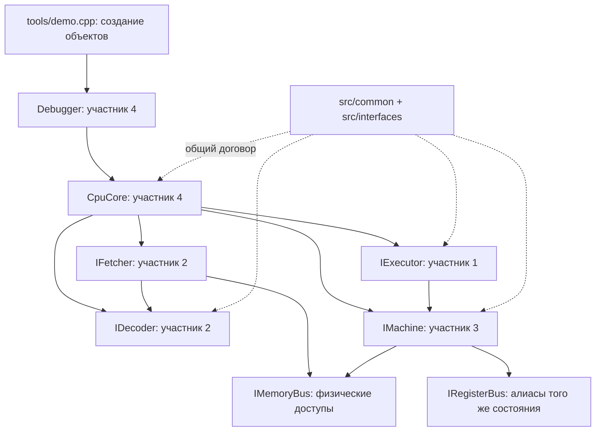
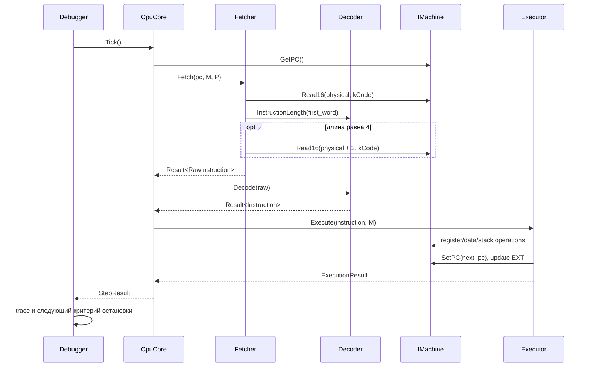

# Архитектура и договор между четырьмя участниками

Документ описывает текущие контракты и минимальный работающий срез.
Аппаратные свойства сверяются с локальными руководствами Infineon, область
совместимости — с [cpu_profile.md](cpu_profile.md). Точные реализованные формы
инструкций перечислены в [isa_scope.md](isa_scope.md). Исходное студенческое ТЗ
сохранено отдельно и требует согласования с этими документами.

## Владельцы

| Участник | Каталоги и цель CMake | Отвечает за | Получает от соседей |
| --- | --- | --- | --- |
| 1. Executor | `src/executor/`, `c166_executor` | Семантика форм, операнды, условия, PSW, изменение PC после команды, стек, события потока, отсчёт EXT | `Instruction`, единый `IMachine` |
| 2. Decoder + Fetcher | `src/decoder/`, `c166_decoder` | Таблица кодировок, длины 2/4, выборка кода, чистый разбор байтов, форматирование | Физический `IMemoryBus` для Fetcher; байты для Decoder |
| 3. Memory | `src/memory/`, `c166_memory` | RAM, регистры и SFR в единой модели, алиасы, endian, маски, доступы, вычисление адресов | Типы адресов, регистров и состояния EXT |
| 4. Debugger и интеграция | `src/debugger/`, `src/core/`, `tools/`; `c166_debugger`, `c166_core` | Сборка объектов, жизненный цикл, цикл Tick, run/step, остановки, trace, осмотр состояния, будущий CLI | Абстрактные контракты остальных трёх модулей |

`src/common/` и `src/interfaces/` — общий договор, а не пятая независимая
подсистема. Владелец debugger собирает общий процесс интеграции; изменение
публичного типа или сигнатуры согласуют все затронутые участники. В частности,
формат `Instruction` согласуют decoder и executor, адресацию — memory и executor,
выход шага — executor и debugger. Изменение общей модели состояния затрагивает
всех четырёх.

Внутреннюю реализацию модуля его владелец меняет самостоятельно. Реализации
не включают заголовки конкретных соседних классов: они зависят от общих типов
и интерфейсов. Конкретные `Machine`, `Decoder`, `Fetcher`, `Executor`, `CpuCore`
и `Debugger` связываются в точке сборки, сейчас это `tools/demo.cpp`.

## Граф зависимостей

| Клиент | Разрешённые зависимости | Ограничение |
| --- | --- | --- |
| Decoder | `common/instruction.h`, `common/result.h` | Не получает machine, регистры или память данных |
| Fetcher | `IDecoder`, `IMemoryBus` | Только code-доступы; PC не меняет |
| Executor | `Instruction`, `IMachine` | Не читает массив RAM напрямую и не разбирает байты opcode повторно |
| Memory | Общие типы и собственный storage | Не исполняет opcode и не определяет момент проверки stack trap |
| CpuCore | `IFetcher`, `IDecoder`, `IExecutor`, `IMachine` | Оркестрирует шаг; не дублирует семантику и не увеличивает PC |
| Debugger | `ICPUCore`, `ITraceSink` | Не исполняет команды и не имеет отдельного register cache |
| Точка сборки | Конкретные классы модулей | Владеет временем жизни объектов |

`CpuCore` хранит заимствованные ссылки: его зависимости должны существовать
дольше core, а core — дольше debugger. `ITraceSink*` также не владеющий;
перед уничтожением sink его нужно отключить либо завершить использование debugger.
Глобальные singleton и скрытые ссылки между модулями не требуются.

## Один Tick

1. Core проверяет, что он не остановлен предыдущей ошибкой, и фиксирует `pc_before`.
2. Fetcher читает первое слово, запрашивает длину из общей с Decode таблицы,
   при необходимости читает второе. Лишних чтений за инструкцией нет.
3. Decoder создаёт описание инструкции. Он не подготавливает снимки значений
   регистров и не вызывает гостевые чтения данных.
4. Core проверяет согласованность исходного PC и длины, затем вызывает executor.
5. Executor проверяет поддержку формы, получает значения операндов и выполняет
   команду. Только он меняет PC в ходе исполнения. Условный переход, который
   не выполнен, также должен завершить шаг с правильным следующим PC.
6. Core возвращает `StepResult`: статус, PC до/после, инструкцию при её наличии,
   диагностическую причину и стадию ошибки, событие потока управления.
7. Debugger передаёт результат в trace и продолжает только при успешном шаге.

Настройка PC через `SetEntryPoint` — отдельная привилегированная операция
жизненного цикла. Она не превращает CSP/IP в обычные гостевые SFR для записи.
Сегмент автоматически не увеличивается. Граничные случаи определены профилем,
а не оставлены свободным выбором каждого модуля.

## Общие данные

- `common/types.h`: типы адресов, `RegisterId`, ширины, биты PSW, состояние EXT.
  `LogicalAddress` и `CodeAddress` отделены от физического адреса.
- `common/instruction.h`: `RawInstruction`, `Instruction`, `Opcode`, `Condition`,
  варианты операндов. Возможны register, immediate, direct, short reg, indirect,
  relative, code target и bit; не все варианты уже исполняются.
- `common/result.h`: `Result<T>` содержит значение либо `Diagnostic`, без
  противоречивых комбинаций «есть значение и ошибка одновременно».
- `common/state.h`: наблюдаемый `CpuSnapshot`.
- `common/execution.h`: результат executor, результат полного шага и состояние core.

Immediate живёт внутри инструкции; ConstantBus и адреса служебного хранилища
констант отсутствуют. `Condition` хранится отдельно от операндов. `rel8` хранится
со знаком в словах. Короткие адреса и косвенные операнды сохраняют способ
адресации; executor обращается к resolver в текущем контексте CPU.

`Opcode` — общий словарь будущих расширений. Его наличие в enum не означает
поддержку decoder или executor; общий источник статуса форм — `isa_scope.md`.

## Единое состояние и адресация

`IMachine` объединяет физическую шину, регистровый доступ и resolver в одном
объекте. Core нельзя собрать из несвязанных хранилищ регистров и памяти.
`Rn` отражает RAM по `CP + 2*n`; `RLn/RHn` отражают те же слова. Именованные
SFR и доступ по их адресам используют одно состояние. Memory применяет
фиксированные биты, маски и правила записи SFR.

`IMemoryBus` принимает только физические адреса. В `ResolveDataAddress`,
`ResolveShortRegister`, `ResolveBitAddress` находятся правила DPP/CP/EXT и
коротких адресов. Executor определяет, когда вычислить адрес, прочитать операнд,
выполнить pre-decrement/post-increment и проверить пределы стека. Поэтому
обычный setter SP не генерирует stack trap после любой записи.

EXT хранится в machine. Executor создаёт или заменяет последовательность,
уменьшает счётчик после обычной успешной инструкции и очищает режим при нуле.
EXT действует на 1–4 следующие инструкции, а не только на одну; его команды
пока вне реализованного среза. Decoder остаётся без состояния CPU.

Гостевые `Read8/Read16/ReadRegister` могут иметь аппаратные побочные эффекты.
Debugger использует `PeekMemory`, `Snapshot`, `InspectInstruction`:
последний запускает тот же Fetch/Decode через адаптер на `Peek8`, поэтому осмотр
инструкции не выполняет её и не вызывает побочных эффектов гостевого чтения.
Если устройство не поддерживает безопасный осмотр, оно должно вернуть ошибку.

`CpuSnapshot` не содержит RAM и не является форматом сохранения машины.
Полное сохранение и восстановление требует отдельного договора.

## Ошибки и жизненный цикл

| Событие | Поведение текущего среза |
| --- | --- |
| Допустимая, но ещё не поддержанная форма | `kUnsupportedInstruction`; executor отклоняет её до изменения состояния |
| Несоответствие известному фиксированному формату | `kInvalidEncoding` с адресом и стадией |
| Ошибка чтения/записи | Исходная диагностика memory сохраняется в результате шага |
| Архитектурный trap | `StepStatus::kTrap` и тип trap; диагностическая остановка |
| Выход за поддержанную границу сегмента | `kSegmentBoundary` как ограничение профиля, без придуманного аппаратного trap |
| Повторный Tick после fault/trap | `kStopped`; новая инструкция не исполняется |

Остановка по trap пока не исполняет аппаратный вход в обработчик, не сохраняет
автоматический trap frame и не читает вектор. Полная эмуляция traps и прерываний
— отдельный этап. Это отличается от ошибки самого эмулятора или неподдержанной
формы инструкции.

Общий контракт не обещает транзакционного отката гостевых операций при ошибке:
чтение MMIO или ранняя запись могли уже иметь эффект. Snapshot показывает
фактическое состояние после остановки. Неподдержанные формы обязательно
отклоняются без мутаций. Для начальных форм проверки операндов и границ делаются
до первой записи.

Создание `Machine` детерминированно обнуляет RAM. `Reset` восстанавливает
моделируемое управляющее состояние CPU и готовность core, сохраняя RAM и
загруженную программу. GPR являются RAM, поэтому их содержимое тоже сохраняется;
после reset снова действует исходный CP. Начальные специальные регистры задают
через `WriteRegister`, точку входа — через `SetEntryPoint`. Эти setter-операции
не снимают fault core: для нового запуска после ошибки нужен `Reset`.
`LoadBinary` проверяет весь диапазон до копирования и не загружает байты в SFR.
Подробные reset-значения и ограничения — в `cpu_profile.md`.

## Управление отладчиком

| API | Договор |
| --- | --- |
| `Step(N)` | Не более N успешных инструкций, остановка на первой ошибке; breakpoint игнорируется |
| `Run(options)` | До лимита инструкций, stop address, breakpoint или ошибки |
| `AddBreakpoint/RemoveBreakpoint` | Адреса остановки проверяются до исполнения инструкции |
| `RunOptions::stop_address` | Остановка до инструкции по адресу; не означает изменение байтов программы |
| `SetTraceSink` | Результат каждой попытки шага и состояние после неё; без собственного исполнения |
| `RunResult` | Причина остановки, число успешно завершённых инструкций, последний шаг при наличии |
| `ICPUCore::PeekMemory/Snapshot/InspectInstruction` | Осмотр без изменения машины |
| `ICPUCore::WriteRegister/SetEntryPoint/LoadBinary` | Явная настройка через правила machine |

`Step` позволяет пройти инструкцию на текущем breakpoint. Обычный `Run` на
том же адресе снова остановится до неё. Лимит защищает тесты и демо от бесконечных
циклов. Интерактивный CLI, step-out и сохранение полного состояния пока не
реализованы и не входят в текущий публичный API.

## Начальный срез и расширение

Сейчас вместе поддержаны пять форм: `NOP`, `MOV Rw,Rw`, `MOV Rw,#data16`,
`ADD Rw,Rw`, `JMPR cc,rel8`. MOV изменяет E/Z/N и сохраняет C/V, ADD обновляет
все пять арифметических флагов. Byte-формы, стек, EXT и остальные формы —
последующая работа, несмотря на наличие типов для них в общем словаре.

Расширение выполняется сквозными группами, без отложенной до конца интеграции:

1. Сохранить работающую программу `MOV/MOV/ADD/JMPR` как базовый сценарий.
2. Добавить адресуемые формы MOV и ALU: decoder описывает форму, memory
   реализует resolver и доступы, executor — порядок операций и флаги.
3. Добавить byte-формы и специальные правила PSW; затем стек и вызовы с явными
   событиями `FlowKind::kCall/kReturn` для будущих возможностей debugger.
4. Добавить bit-команды, EXT и выбранный объём системных возможностей,
   предварительно обновив профиль и правила traps.

Каждая форма поставляется с точной кодировкой и ссылкой на руководство,
тестом Decode, тестом семантики и сквозной проверкой через core. Если изменение
одного модуля пока не поддержано соседями, форма не помечается как готовая.

## Проверки и интеграция

| Владелец | Обязательные проверки |
| --- | --- |
| Decoder + Fetcher | Длины, fixed fields, нибблы, знаковый rel8, условия, отсутствие лишних чтений, границы сегмента; fake bus позволяет работать независимо |
| Memory | GPR/RAM и SFR/register coherence, CP, RL/RH, DPP/EXT, маски, endian, выравнивание, безопасный осмотр, атомарная проверка диапазона загрузки |
| Executor | Результаты и весь затрагиваемый PSW, условные переходы, PC, неподдержанные формы без мутаций; затем порядок stack/bit/EXT эффектов |
| Debugger и интеграция | Загрузка и настройка → Tick → snapshot, остановки до команды, step через breakpoint, лимит, trace, sticky fault и reset |

Каждый модуль можно собрать отдельной целью `c166_memory`, `c166_decoder`,
`c166_executor`, `c166_core`, `c166_debugger`. Модульные тесты executor и decoder
используют fake-зависимости; отдельный integration-тест связывает все реальные модули.
`c166_header_checks` компилирует каждый публичный заголовок отдельно. Сборка,
CTest и демо описаны в [README](../README.md). Форматирование проверяется
`./scripts/check-format.sh`.
