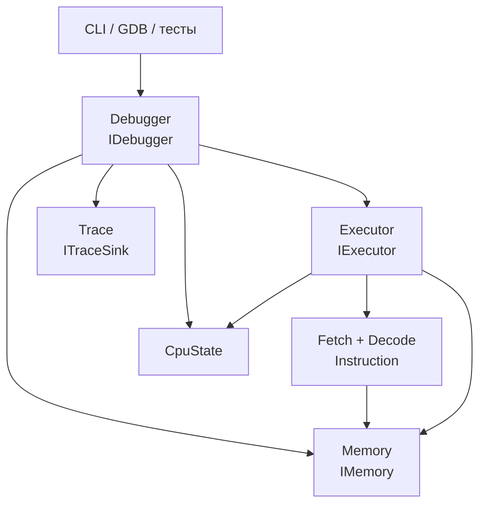
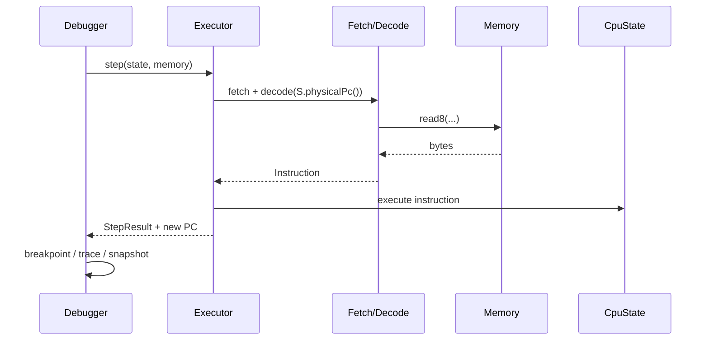

# Архитектура эмулятора C166

Каркас фиксирует границы, по которым четыре участника могут работать
параллельно. Заголовки в `src/includes/` являются API; реализация конкретного
модуля может меняться без изменения соседних компонентов.

## Владение и зависимости



* **Fetch + Decode** читает окно байт и строит `Instruction`; состояние не
  изменяется.
* **Executor** владеет переходом `IP`, регистрами, PSW и стеком во время
  выполнения. `step()` выполняет одну инструкцию, `execute()` — декодированную.
  Для реализации конкретных групп инструкций он может делегировать операции
  интерфейсам `IAlu`, `IBitProcessor`, `IStack`, `IDataTransfer` и
  `IControlInstructions`.
* **Memory** — единственный способ доступа к памяти. Здесь добавляются DPP,
  выравнивание и MMIO.
* **Debugger** хранит брейкпоинты и управляет `step(N)`, `run()`, `stepInto()`
  и `stepOut()`.
* **Trace** получает записи после шага и может писать весь запуск или N шагов.

## Поток одного шага



## Отладочные операции

| Команда | Контракт | Семантика |
| --- | --- | --- |
| breakpoint set/remove | `addBreakpoint` / `removeBreakpoint` | остановка до инструкции по адресу |
| step N | `step(N)` | не более N инструкций |
| run | `run()` | продолжение до брейкпоинта, halt или ошибки |
| step in | `stepInto()` | одна инструкция, включая вход в CALL |
| step out | `stepOut()` | выполнение до возврата из текущего вызова |
| trace | `ITraceSink` | состояние после каждого шага |
| inspect/write | `snapshot`, `readMemory`, `writeMemory`, `writeRegister` | просмотр и изменение |

`stepOut()` требует от Executor определить глубину вызовов или адрес возврата;
это намеренно оставлено в реализации Executor, а не зашито в Debugger.

## Проверка стиля

Для C++ используется `.clang-format` на базе Google Style с шириной строки
100 символов. Локальная проверка выполняется командой:

```bash
./scripts/check-format.sh
```

Та же проверка запускается в GitHub Actions workflow `style` для каждого push и
pull request. Исправить форматирование всех исходников можно командой:

```bash
clang-format -i $(find src tests tools -type f \( -name '*.cpp' -o -name '*.h' \))
```
